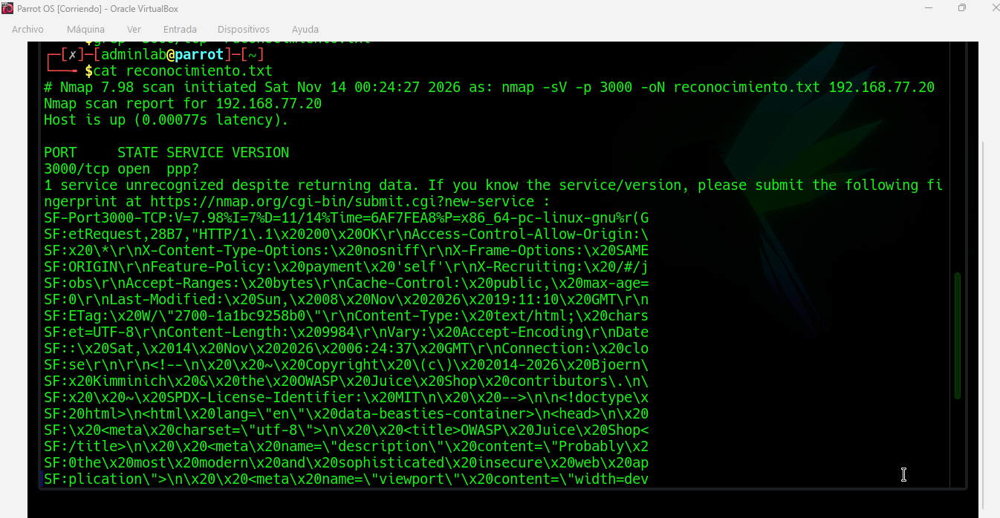
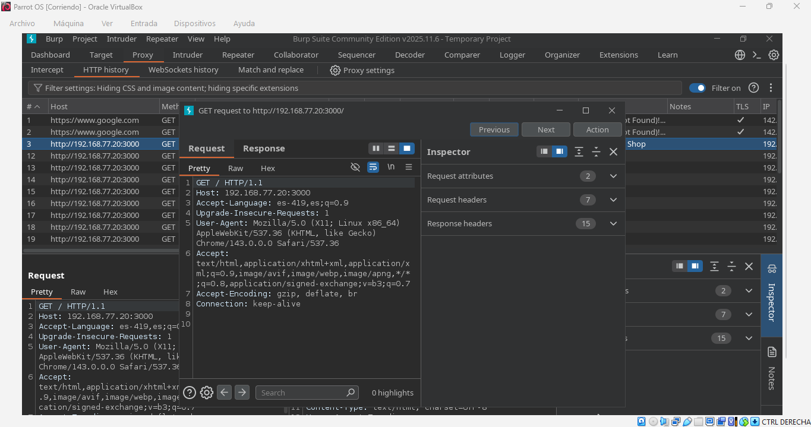
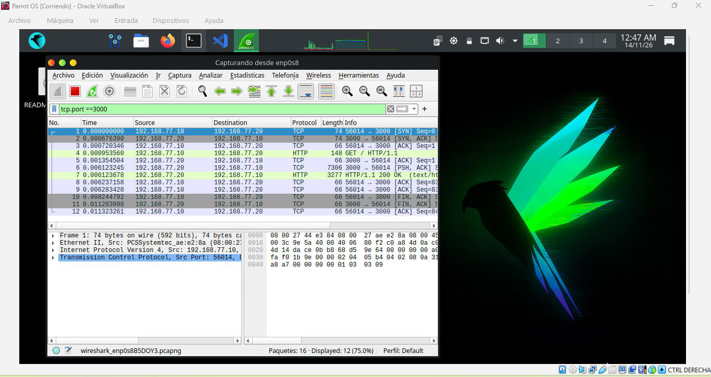
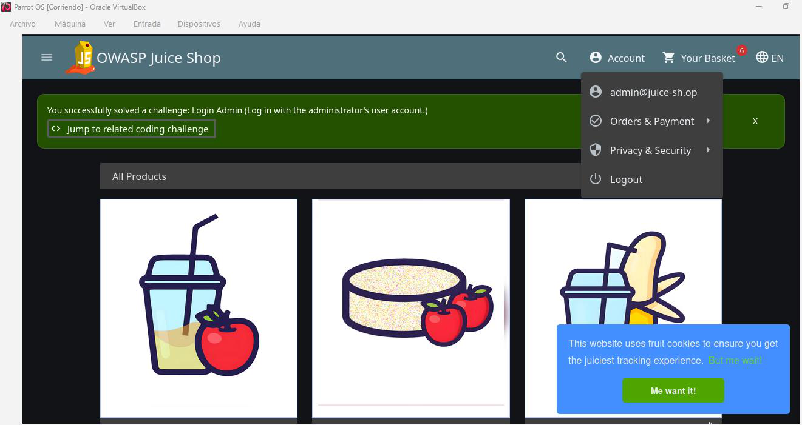
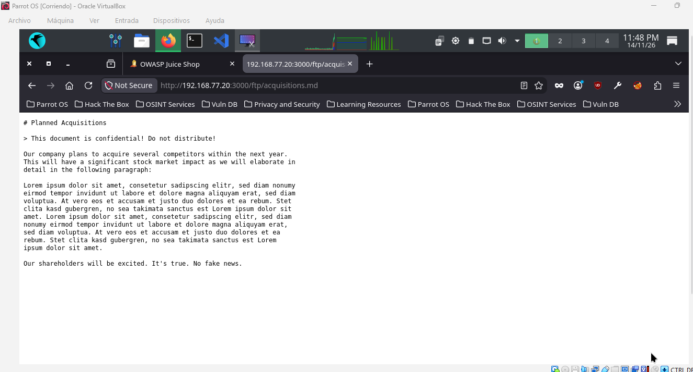
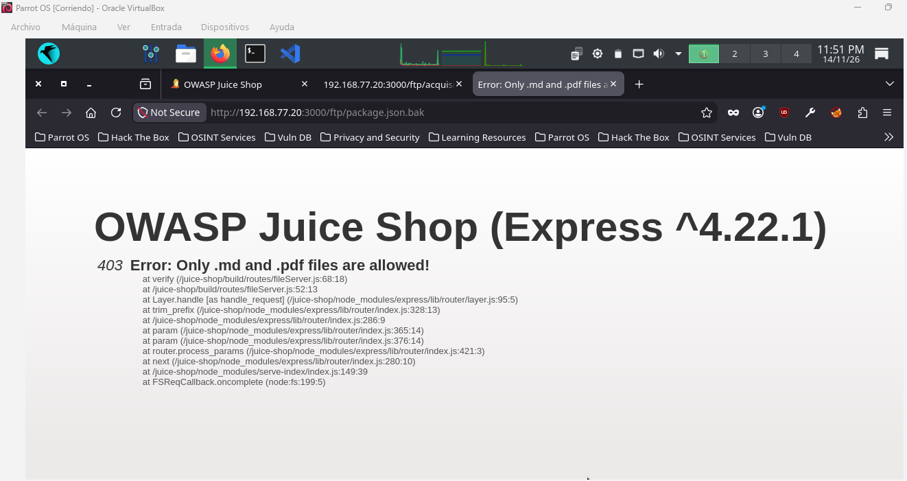

# Operación Centinela | Auditoría de Seguridad Web

## Descripción
Proyecto académico colaborativo realizado en el Módulo 4 de Ciberseguridad de la Universidad Latina de Costa Rica.

Se evaluó la seguridad de OWASP Juice Shop, utilizada como aplicación de entrenamiento para una empresa ficticia llamada NovaRetail. El laboratorio se desarrolló en un entorno virtual controlado.

## Objetivos
- Configurar un laboratorio virtual y una red interna.
- Identificar servicios disponibles y analizar tráfico de red.
- Realizar pruebas controladas de seguridad web.
- Documentar hallazgos y proponer medidas de remediación.

## Herramientas utilizadas
- Oracle VirtualBox
- Parrot Security OS
- Ubuntu Server
- Docker y OWASP Juice Shop
- Nmap
- Burp Suite Community
- Wireshark

## Entorno del laboratorio
- Red interna: CYBERLAB (192.168.77.0/24).
- Máquina auditora: Parrot Security OS (192.168.77.10).
- Servidor objetivo: Ubuntu Server / NovaRetail (192.168.77.20).
- Aplicación web: OWASP Juice Shop, puerto TCP 3000.

## Metodología
1. Preparación y validación del entorno virtual.
2. Reconocimiento de servicios mediante Nmap.
3. Auditoría web controlada con navegador y Burp Suite.
4. Captura y análisis de tráfico con Wireshark.
5. Documentación de hallazgos y elaboración del plan de remediación.

## Hallazgos documentados
| Hallazgo | Severidad preliminar |
| --- | --- |
| Inyección SQL en autenticación | Alta |
| Exposición de documentación confidencial | Alta |
| Políticas de contraseñas insuficientes | Media |
| Divulgación de información técnica mediante mensajes de error | Baja |

## Plan de remediación propuesto
- Utilizar consultas SQL parametrizadas en la autenticación.
- Restringir el acceso a documentos internos y revisar permisos.
- Rechazar contraseñas comunes o comprometidas y considerar MFA.
- Mostrar mensajes de error genéricos y proteger los registros técnicos.

Estas medidas fueron propuestas en el informe académico; no se documentó su implementación.

## Aprendizajes
Este laboratorio permitió practicar reconocimiento de servicios, análisis de tráfico TCP/HTTP, evaluación básica de seguridad web, clasificación de hallazgos y elaboración de documentación técnica.

## Alcance y autoría
Proyecto académico realizado en equipo, dentro de un laboratorio autorizado y aislado. La aplicación evaluada fue OWASP Juice Shop, diseñada para entrenamiento. Esta documentación resume el trabajo colaborativo y no representa una auditoría profesional de una organización real.

## Evidencias del laboratorio

### 1. Reconocimiento con Nmap

### 2. Análisis HTTP con Burp Suite

### 3. Análisis de tráfico con Wireshark

### 4. Prueba de inyección SQL

### 5. Exposición de documentación

### 6. Divulgación de información técnica

